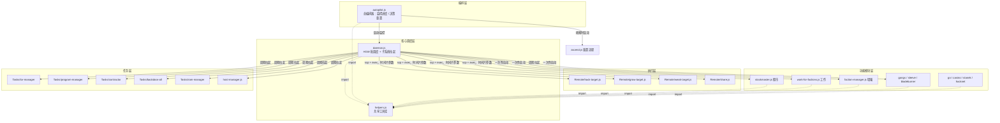

# 01 · 整体架构

[← 首页](README.md) | [下一页：核心模块 →](02-核心模块.md)

## 1. 运行环境模型

本仓库的脚本不运行在 Node.js 中，而是运行在 **Bitburner 游戏进程内嵌的 Netscript 2.0 引擎**里：

- 每个脚本是一个 ES Module，入口为 `export async function main(ns)`，`ns` 是游戏注入的全局 API 对象（`ns.hack`、`ns.singularity.*`、`ns.stock.*`、`ns.gang.*` …）
- 游戏内**每个函数调用都消耗 RAM**——这是全仓库最重要的资源约束，直接塑造了代码风格（见 §4「RAM 经济学」）
- 脚本通过 `ns.run / ns.spawn / ns.exec` 互相启动，通过 `ns.scp` 把自身复制到被破解的远程服务器上执行
- 游戏内"文件系统"是虚拟的：`home` 是本机，其余为网络中的服务器节点

## 2. 分层架构



**分层职责：**

| 层 | 代表 | 职责 |
|---|---|---|
| 编排层 | `autopilot.js` | 感知游戏阶段（BN、资金、hack 等级、SourceFile），决定启动哪些子系统、何时 casino、何时 ascend |
| 核心调度层 | `daemon.js` + `helpers.js` | 网络破解、目标排序、RAM 预算分配、HGW 批循环调度、拉起全部子系统 |
| 执行层 | `Remote/*` | 极小的 worker（3–43 行），被 scp 到目标服务器，按预定时间片执行单次/循环 hack、grow、weaken、share |
| 功能模块层 | 各子系统脚本 | 长期运行的领域自动化（股市、派系、帮派…），各自独立闭环 |
| 任务层 | `Tasks/*`、`host-manager.js` | 短生命周期任务：daemon 每 ~25–33s 错峰拉起一次，做完即退出 |

## 3. 启动链

```
玩家手动: run autopilot.js
  └─ autopilot.js
       ├─ 早期: casino.js（可选，启动资金） 
       ├─ run daemon.js  ─────────────────────────────────────┐
       │    ├─ 常驻异步助手: stats / go / stockmaster /        │
       │    │   sleeve / gangs / work-for-factions /          │
       │    │   bladeburner / spend-hacknet-hashes            │
       │    ├─ 周期任务: tor-manager → program-manager →      │
       │    │   contractor → hacknet-upgrade-manager ×3 →     │
       │    │   ram-manager → faction-manager →               │
       │    │   host-manager → backdoor-all-servers           │
       │    └─ HGW 批循环: scp Remote/* 到目标机并 exec        │
       ├─ 条件满足: stanek.js（接受 Stanek 礼物后）             │
       └─ 检测到可重置: ascend.js → faction-manager --purchase
            → installAugmentations / softReset → 自动重启 daemon
```

每个常驻脚本都做了**单实例保护**（`instanceCount(ns) > 1` 则自我退出），因此重复启动是安全的。

## 4. HGW 时间片批调度（核心机制）

`daemon.js` 不使用端口或消息做同步，而是**纯时间计算 + 参数下发**的调度模型：

1. daemon 用 `ns.formulas.hacking`（或实测）计算目标的 `hackTime / growTime / weakenTime`（比例约 1 : 3.2 : 4）
2. 为一个批周期（cycle）计算 `start_time` 与 `duration`，使 hack → grow → weaken 按序收尾、错峰 `--queue-delay`（默认 200ms 间隔）
3. `ns.exec` 启动 worker，把 `target, start_time, duration, manipulateStock, silentMisfires, loopingMode` 作为参数传入
4. worker（如 [Remote/hack-target.js](../Remote/hack-target.js)）将等待时间打包进 `ns.hack(target, { additionalMsec })`，到点即执行——**等待期间不占用 daemon 的任何资源**

```js
// worker 侧核心逻辑（Remote/hack-target.js）
let sleepDuration = start_time - Date.now();
if (sleepDuration < 0) ns.toast(`Misfire: ...`, 'warning');   // 迟到即 misfire
const hgwOptions = { stock: manipulateStock, additionalMsec: sleepDuration };
if (loopingMode) hgwOptions.additionalMsec += duration * 3.0;  // 对齐到 weaken 周期
do { const stolen = await ns.hack(target, hgwOptions); ... } while (loopingMode);
```

**两种运行模式：**

| | 默认模式 | `--looping-mode` |
|---|---|---|
| worker 生命周期 | 每次操作 spawn 新进程 | 长生命周期，内部循环对齐 weaken 周期 |
| 适用阶段 | 前中期（操作耗时秒级以上） | 末期（hack 等级 8000+，操作为毫秒级） |
| 风险 | 进程开销大 | 更易 misfire，需 `--recovery-thread-padding`（默认自动提到 10）补偿乱序 |

**配套机制：**
- `--stock-manipulation`：worker 的 `stock: true` 选项让 hack/grow 影响股价，与 `stockmaster.js` 的多空持仓联动获利
- `-x / --xp-only`：只追求 hack 经验；自动隐含 `--no-share`
- `share`：空闲 RAM 跑 `Remote/share.js` 提升派系声望增益
- misfire 恢复：乱序执行导致服务器状态偏离时，用 grow/weaken 的恢复线程把目标拉回健康状态

## 5. RAM 经济学：`getNsDataThroughFile` 模式

游戏内调用 `ns.getServer()` 等函数会让**当前脚本**的 RAM 占用永久上涨。仓库的解法是 helpers.js 中的核心技巧：

```js
getNsDataThroughFile(ns, 'ns.getServer(ns.args[0])', '/Temp/getServer.txt', ['n00dles'])
```

它动态生成一个**临时脚本**（写入 `/Temp/*.js`），以 `{ temporary: true }` 运行，把结果 `ns.write` 到 `/Temp/*.txt`，父脚本再读文件反序列化。代价全部落在即用即焚的临时进程上，主脚本保持 1.6 GB 基础占用。全仓库大量 `/Temp/` 文件由此而来，`cleanup.js` 专门清理它们。

## 6. 通信与共享状态

仓库**没有使用 ns 端口做 IPC**，进程间协作通过：

| 机制 | 载体 | 用途 |
|---|---|---|
| 文件 | `reserve.txt` | 全局资金保留额，`reserve.js` 写入，所有带支出逻辑的脚本读取 |
| 文件 | `<script>.js.config.txt` | 持久化参数覆盖（见 [运行与配置](07-运行与配置指南.md)） |
| 文件 | `/Temp/*.txt` / `/Temp/*.js` | 临时脚本 IPC、contract 数据、分析结果 |
| 进程表 | `ns.ps()` | 实例去重（`instanceCount`）、判断脚本是否在跑、按 args 识别任务 |
| 时间对齐 | worker 参数 | HGW 调度（见 §4） |
| 终端/toast | `ns.tprint / ns.toast` | 通知玩家关键事件（买到 TOR、misfire、可 hack w0r1d_d43m0n 等） |

## 7. 关键设计取舍

1. **可独立运行**：几乎每个脚本都能单独 `run`，编排器只在"未运行"时拉起它（按文件名判断，与参数无关）——方便玩家用自定义参数先行启动
2. **单实例保护**：所有常驻脚本入口检查 `instanceCount`
3. **防御性降级**：SF4（Singularity）不可用时自动跳过相关子系统；公式 API 不可用时回退到实测
4. **一切可配**：每个脚本顶部都有 `argsSchema`，支持 `--help`、`autocomplete`、config.txt 覆盖
5. **按 BN 感知**：通过 `dictSourceFiles`（已拥有的 SourceFile）与 `bitNodeMults` 调整行为，如 BN8 不跑 bladeburner、hacknet 收益为 0 的 BN 不买节点

[← 首页](README.md) | [下一页：核心模块 →](02-核心模块.md)
