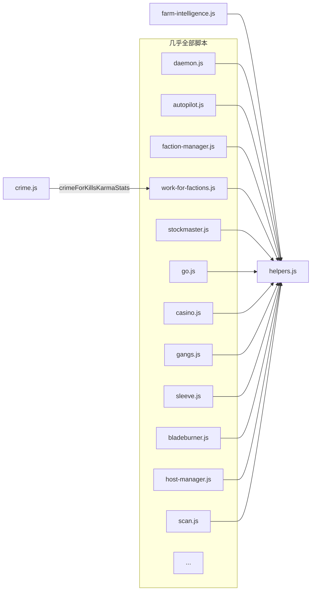

# 06 · 依赖关系

[← 上一页：关键类与函数](05-关键类与函数.md) | [返回首页](README.md) | [下一页：运行与配置 →](07-运行与配置指南.md)

## 1. 代码依赖（import）

仓库唯一的共享代码单元是 `helpers.js`（`Tasks/` 下脚本以 `../helpers.js` 引入）。显式 import 关系：



- **`helpers.js` 被 ~30 个脚本 import**，是唯一硬依赖；改它等于改全部
- `crime.js` 额外依赖 `work-for-factions.js` 的 `crimeForKillsKarmaStats` 导出
- `Remote/*` worker **刻意零依赖**（不 import helpers）——它们要被 scp 到远程服务器，保持极小体积
- 例外：daemon 远程执行前会检查并复制 `helpers.js` 等依赖（[daemon.js#L1647-L1661](../daemon.js)）

## 2. 启动依赖（谁拉起谁）

```mermaid
graph TD
    P[玩家手动] --> GP[git-pull.js] --> CL[cleanup.js]
    P --> AP[autopilot.js]
    AP -->|早期攒钱| CAS[casino.js]
    AP -->|主力| DM[daemon.js]
    AP -->|Stanek 礼物可用后| STN[stanek.js]
    STN -->|无布局时| STC[stanek.js.create.js]
    AP -->|条件满足| ASC[ascend.js]
    ASC -->|购买增强| FM2[faction-manager.js --purchase]
    ASC -->|清算| SM2[stockmaster --liquidate / spend-hacknet-hashes --liquidate]

    DM -->|常驻异步助手| S1[stats.js] & S2[stockmaster.js] & S3[go.js] & S4[sleeve.js]
    DM --> S5[gangs.js] & S6[work-for-factions.js] & S7[bladeburner.js] & S8[spend-hacknet-hashes.js]
    S6 -.->|资金够时 hash 买 contract| HH[ns.hacknet]
    BB2[bladeburner.js] -.->|启动| S8
    STN -.->|临时 charge 脚本| TMP[/Temp/*]

    DM -->|周期拉起| T1[tor-manager] & T2[program-manager] & T3[contractor]
    DM --> T4[hacknet-upgrade-manager ×3] & T5[ram-manager] & T6[faction-manager]
    DM --> T7[host-manager] & T8[backdoor-all-servers]
    T3 -->|延时低 RAM 启动| TS[contractor.js.solver.js]
    T8 --> TB[backdoor-one]
    DM -->|破解新服务器| TC[crack-host.js]
    DM -->|scp+exec HGW| R[Remote/* workers]
```

## 3. 共享状态文件

| 文件 | 写者 | 读者 | 作用 |
|---|---|---|---|
| `reserve.txt` | `reserve.js` / `ascend.js`（清空） | host-manager、ram-manager、daemon 等所有支出方 | 全局资金保留额 |
| `<script>.js.config.txt` | 玩家手建 | `getConfiguration` | 持久参数覆盖 |
| `/Temp/*.js` / `*.txt` | `getNsDataThroughFile` / `runCommand` | 调用方脚本 | 低 RAM 执行与 IPC（`cleanup.js` 清理） |
| `/Temp/unsolved-contracts.txt` | contractor.js.solver.js | 同左 | 记录无解合约避免重复告警 |
| `/Temp/analyze-hack.txt` | analyze-hack.js | 玩家 | 收益排行结果 |
| `/Temp/terminal-command.js` | run-command.js | — | 终端命令执行体 |

> 注意：脚本间**不使用 ns 端口通信**；同步靠文件、进程表（`ns.ps`）与时间片参数（见[架构 §4/§6](01-整体架构.md)）。

## 4. 游戏机制前置依赖

| 前置 | 影响的脚本 |
|---|---|
| SF4（Singularity） | work-for-factions、crime、farm-intelligence、faction-manager、ascend、tor/program-manager、backdoor-all-servers、ram-manager、Remote/manualhack-target |
| SF9（Hacknet Hash） | spend-hacknet-hashes（及 bladeburner 的 hash 联动） |
| SF10（Sleeve） | sleeve.js |
| SF2（Gang） | gangs.js |
| SF7（Bladeburner） | bladeburner.js |
| 4S 数据/API | stockmaster 的精准预测（无则用统计预测） |
| BN 限制 | BN8 不跑 bladeburner；hacknet 收益为 0 的 BN 跳过升级；`dictSourceFiles`/`bitNodeMults` 全局感知 |

所有条件启动逻辑集中在 daemon 的 `shouldRun` 谓词与 autopilot 的调度段，因此**缺少某个 SF 不会报错，只是对应子系统不启动**。

---

[← 上一页：关键类与函数](05-关键类与函数.md) | [返回首页](README.md) | [下一页：运行与配置 →](07-运行与配置指南.md)
